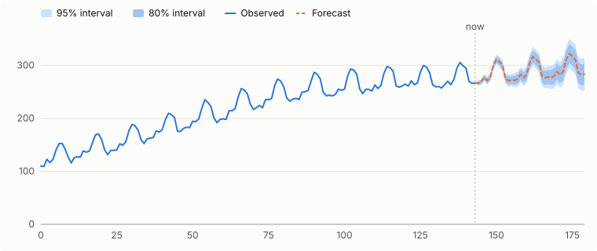
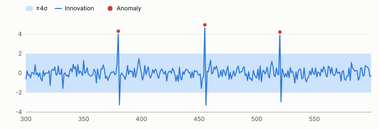
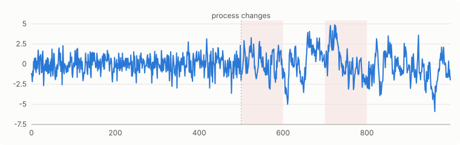
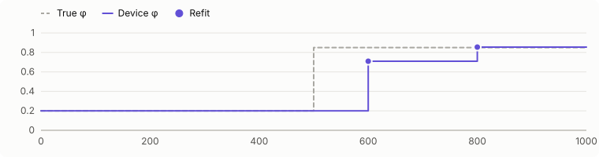

# backshift

[](https://crates.io/crates/backshift)
[](https://docs.rs/backshift/)
[](https://github.com/sunsided/arima-rs/actions/workflows/ci.yml)
[](#license)

Seasonal ARIMA models for Rust, fitted by exact maximum likelihood, with a streaming filter that runs on targets without a heap.
A model is fitted wherever there is an allocator (a laptop, a server, statsmodels if you prefer), and its coefficients are
all a microcontroller needs to filter new values and forecast them with prediction intervals. The name is the backshift
operator `B` that ARIMA models are written in: `(1 - B)^d y_t` is the series differenced `d` times.

**[Try it in the browser](https://sunsided.github.io/arima-rs/)**: fit, forecast, stream and refit, compiled to
WebAssembly.

<picture>
  <source media="(prefers-color-scheme: dark)" srcset="https://raw.githubusercontent.com/sunsided/arima-rs/main/docs/img/forecast-dark.svg">
  
</picture>

```rust
use backshift::{Arima, Filter};

let history = [0.3, 1.1, 0.4, -0.2, 0.9, 1.4, 0.6, 0.1, -0.5, 0.2, 0.8, 1.0, 0.3, -0.1, 0.4];
let fitted = Arima::new(1, 0, 0).fit(&history).unwrap();
println!("AIC {:.2}", fitted.aic());

// The device side needs only the coefficients.
let mut filter = Filter::<4>::new(&fitted.spec()).unwrap();
filter.warm_up(&history);
let innovation = filter.update(0.7).unwrap();

let (mut mean, mut lower, mut upper) = ([0.0; 3], [0.0; 3], [0.0; 3]);
filter.forecast_interval_into(0.95, &mut mean, &mut lower, &mut upper);
```

## Who is this for

The crate is for running ARIMA where statsmodels won't go: on a microcontroller watching a sensor, in WebAssembly,
or in a Rust service that would rather not link BLAS. The streaming filter is the part that sets it apart. Each new value
costs one Kalman step in `O(r²)` for `r = max(p, q + 1)` states, the innovation it returns doubles as an anomaly score
(its variance comes with it), and the whole state lives inline in a `Copy` struct.

<picture>
  <source media="(prefers-color-scheme: dark)" srcset="https://raw.githubusercontent.com/sunsided/arima-rs/main/docs/img/stream-dark.svg">
  
</picture>

For model selection it has the Hyndman–Khandakar stepwise search of R's `auto.arima`. Its choices match pmdarima's on
the test series once the differencing orders are fixed. The differencing tests themselves differ on purpose: `D` comes
from STL seasonal strength (R's default) rather than pmdarima's OCSB test, which misses the seasonal unit root of a
simulated airline series that the crate finds. In Rust, [`foresight`](https://crates.io/crates/foresight) also offers
a stepwise auto-ARIMA, but does not build for bare-metal targets.

## What's in it

- `Arima::new(p, d, q).seasonal(P, D, Q, s).fit(y)`: exact Gaussian maximum likelihood with `sigma2` concentrated out, Hannan–Rissanen
  starting values, refined by a conditional-sum-of-squares warm start (R's `CSS-ML`), and an in-crate BFGS; AR and MA parts stay stationary and invertible through statsmodels' PACF
  transforms. `Fitted` reports the log-likelihood, AIC, AICc and BIC.
  `fit_from` starts the optimiser from a previous fit or a related model instead (R's `arima(init=)`), and `fit_fixed`
  keeps whole parts at given values (R's `arima(fixed=)`, statsmodels' `fix_params`).
  `.method(Method::Css)` stops at the conditional-sum-of-squares estimates (R's `method="CSS"`): 8× faster on the
  airline model, 0.003 below its maximum log-likelihood, more on short strongly seasonal series.
  `fit_pmm2` refines a fit by PMM2 for skewed innovations; on simulated Gamma(2,1) innovations its AR estimates had
  1.4–2× less mean squared error than maximum likelihood, and the same with Gaussian ones.
- `Filter<R, M>`: built from an `ArimaSpec` alone, it expands the seasonal polynomials into its own arrays, differences raw values in place, returns one-step innovations,
  treats `NaN` as missing, and forecasts original-scale means, variances and intervals. `R` is the state capacity,
  `ArimaSpec::states()`, i.e. `max(p + P s, q + Q s + 1) + d + D s`; the airline model ARIMA(0, 1, 1)(0, 1, 1, 12)
  needs `R = 27`. `M` (default 0) holds the regression coefficients and does not grow the covariance.
  `with_steady_state()` opts into statsmodels' default steady-state shortcut: once the covariance converges, each
  update costs `O(R)` instead of `O(R²)`, and the results match statsmodels with its default tolerance.
- `Conformal<H, N>`: heap-free conformal prediction intervals next to the filter's Gaussian ones. A rolling buffer of
  the last `N` absolute `h`-step errors per horizon gives the half-width, so the intervals hold their coverage under
  skewed or heavy-tailed noise without a change to the model (on one series this is empirical, not guaranteed).
- `OnlineAr<M>`: an adaptive AR(`M`) predictor that learns its coefficients one value at a time (ARMA-ONS, Anava et
  al. 2013), heap-free, for series whose dynamics drift or switch. It trades the filter's exact likelihood,
  variances and statsmodels parity for adaptation without a refit.
- Regression with ARIMA errors: `fit_exog`, `update_exog`, `forecast_exog_into` and friends model `y_t - x_t . beta`
  with the regressors differenced along with `y`, as R's `arima(xreg=)` does. [`examples/holidays_outages.rs`](https://github.com/sunsided/arima-rs/blob/main/examples/holidays_outages.rs)
  fits daily users with bank-holiday and outage dummies, and forecasts through a known upcoming holiday.
- Fourier regressors: `fourier_row` (heap-free, one row per new value on a device) and `fourier` (several periods
  at once) give sine/cosine pairs in the column order of R's `forecast::fourier()`. With `fit_exog` and
  `update_exog` they model long or non-integer seasons (365.25, 8766) as dynamic harmonic regression, which a
  seasonal ARIMA cannot hold in memory.
  `AutoArima::fit_fourier` picks the number of harmonics per period by the search criterion (AICc by default), as
  FPP3 recommends.
- `loglike` and `innovations` (and their `_exog` forms) for any model size, through the same recursion as the filter.
- `AutoArima`: the stepwise search (or an exhaustive one, parallel with the `rayon` feature) with `ndiffs` and
  `nsdiffs` choosing `d` and `D`; AICc by default, AIC or BIC on request. `.approximation(true)` ranks the candidates
  by CSS fits and refits only the winner exactly (R's `approximation=TRUE`): 15× faster on the airline series, with
  the same choice there and on 7 of the 8 pmdarima series (the eighth is a tie within 0.01 AICc).
- `Ets`, `AutoEts` and `EtsFilter<M>`: exponential smoothing in R's `forecast::ets` form, all 15 models of R's default
  set (additive or multiplicative error; no, additive or damped trend; no, additive or multiplicative season). With
  additive components the fit concentrates the initial states out by least squares and searches only the smoothing
  parameters; with multiplicative ones it optimises them jointly from R's starting states. It reaches the same or a
  higher likelihood than R on every model of its conformance suite. The heap-free `EtsFilter` continues from a fit's
  final states at `O(1)` per value and forecasts with R's analytic intervals (classes 1 to 3, the last in caller
  scratch), corrected where R's are off (ETS(A,N,A), ETS(M,N,A), ETS(M,Ad,M)).
- `stl`: STL decomposition with statsmodels' defaults, and the seasonal strength it implies.
- `mstl`: MSTL for several seasonal periods (daily and weekly on hourly data), and `stl_with` for a chosen seasonal
  window; both match statsmodels to 1e-9. `box_cox` and `box_cox_lambda` (scipy's maximum-likelihood lambda) transform
  the series first, as statsmodels' `MSTL(lmbda=...)` does.
  `AutoArima::fit_mstl` forecasts with MSTL plus ARIMA (R's `stlf`): ARIMA on the seasonally adjusted series, each
  seasonal component's last cycle repeated; the intervals ignore the seasonal components' uncertainty.
  `MstlArima::stream` turns the fit into a heap-free `MstlFilter<R, L>` for devices: a filter on the adjusted series plus
  the last cycle of each period.
- `find_period`: ranked seasonal period candidates by coreforecast's rule (the autocovariance of the first differences,
  confirmed by STL seasonal strength above 0.64), to feed `AutoArima::seasonal`, `stl` or `fourier`. A heuristic.
- Diagnostics: `ljung_box`, `jarque_bera` and `kpss` (heap-free, so a device can check its own residuals), and
  `ndiffs` to choose `d`.
- The building blocks: `acov`, `acorr`, `pacf`, `difference`, `integrate`, `yule_walker`, `burg`, `hannan_rissanen`
  and `normal_quantile`.

## Running without a heap

The crate is `no_std`. With `default-features = false` pick one of the floating-point backends:

| Features | For |
|---|---|
| `std` (default) | Everything, using the standard library's math functions. Implies `alloc`. |
| `libm` | Bare-metal targets: `TimeSeries`, `acov`/`acorr`, `Filter`, `ArimaSpec::refit`, the diagnostic tests and `normal_quantile`. No allocator needed. |
| `libm`, `alloc` | Bare-metal targets with an allocator: adds fitting, `pacf`, differencing and the estimators. |
| `rayon` | Fits the candidates of an exhaustive `AutoArima` search in parallel. Implies `std`. |

```toml
[dependencies]
backshift = { version = "0.1", default-features = false, features = ["libm"] }
```

CI links a `no_std`/`no_main` binary for `thumbv7em-none-eabihf` that runs an ARIMA(1,1,1) filter, forecasts with
intervals and refits the model, and a counting allocator asserts that `Filter::new`, `update`, `warm_up`, the
forecasts, the diagnostic tests and a refit allocate nothing. That binary comes out at about 52 KB of `.text`, of which
the refit is about 21 KB. The filter's state lives inline:

| Capacity (`M = 0` unless given) | `size_of::<Filter<R, M>>()` | Fits, for example |
|---|---|---|
| `R = 4` | 384 bytes | ARIMA(1,1,1), ARIMA(2,1,2) |
| `R = 8` | 960 bytes | ARIMA(2,0,1)(1,0,0,4) |
| `R = 16` | 2,880 bytes | ARIMA(1,0,0)(1,0,0,12) |
| `R = 27` | 7,192 bytes | the airline model ARIMA(0,1,1)(0,1,1,12) |
| `R = 3, M = 50` | 680 bytes | an ARMA(2,2) error with 50 regressors, such as Fourier terms |

`Filter::new` needs about three times that on the stack while it solves for the starting covariance, and the
forecasts about twice.

## Refitting on the device

`ArimaSpec::refit` re-estimates a model by exact maximum likelihood on a window of recent values, without a heap. It
starts from the model's current coefficients and runs the same objective and optimiser as `Arima::fit`, so a device
can notice that its innovations are no longer white (`ljung_box` on them) and adapt in place. The caller owns all
memory: `refit_scratch_len` and `coefficient_len` are `const fn`s, so `Refitter` can hold both buffers in a `static`.

```rust
use backshift::{ArimaSpec, Filter, RefitOptions, Refitter, Seasonal};

const MODEL: ArimaSpec<'static> = ArimaSpec {
    ar: &[0.5], d: 1, ma: &[0.3], seasonal: Seasonal::NONE, exog: &[], mean: 0.0, sigma2: 1.0,
};
const WINDOW: usize = 64;
const OPTIONS: RefitOptions = RefitOptions { mean: true, max_iterations: 100 };
static REFITTER: std::sync::Mutex<
    Refitter<{ MODEL.refit_scratch_len(WINDOW, OPTIONS) }, { MODEL.coefficient_len() }>,
> = std::sync::Mutex::new(Refitter::new());

let window: [f64; WINDOW] = core::array::from_fn(|t| 0.1 * t as f64 + ((t * 7) % 5) as f64 / 4.0);
let mut refitter = REFITTER.lock().unwrap();
let refit = refitter.refit(&MODEL, &window, OPTIONS).unwrap();
let mut filter = Filter::<4>::new(&refit.spec).unwrap();
filter.warm_up(&window); // continue from the end of the window
```

A failed refit, such as `FitError::Degenerate` from a stuck sensor, leaves the running model untouched. The scratch is
about `4 r² + (exog.len() + 2) n` values for `r` ARMA states and `n` differenced values: 2.2 KB for ARIMA(1,1,1) with
drift over 100 values, 9.3 KB for the airline model over 144. [`examples/device_refit.rs`](https://github.com/sunsided/arima-rs/blob/main/examples/device_refit.rs)
runs the whole loop: stream, check every window, refit on drift, swap:

<picture>
  <source media="(prefers-color-scheme: dark)" srcset="https://raw.githubusercontent.com/sunsided/arima-rs/main/docs/img/drift-dark.svg">
  
</picture>
<picture>
  <source media="(prefers-color-scheme: dark)" srcset="https://raw.githubusercontent.com/sunsided/arima-rs/main/docs/img/drift-coefficient-dark.svg">
  
</picture>

## In JavaScript

The [`@sunsided/backshift`](https://www.npmjs.com/package/@sunsided/backshift) npm package brings fitting, forecasts,
the streaming filter and refits to the browser and Node through WebAssembly, built from the same code with the `libm`
backend. The [demo site](https://sunsided.github.io/arima-rs/) runs on it; [`bindings/wasm`](https://github.com/sunsided/arima-rs/tree/main/bindings/wasm) has the
API.

## Checked against statsmodels and R

Every result is compared with statsmodels 0.14 on reference series generated by
[`scripts/generate_reference.py`](https://github.com/sunsided/arima-rs/blob/main/scripts/generate_reference.py):

| What | Against | Tolerance |
|---|---|---|
| `acorr`, `pacf`, `acov`, `yule_walker`, `burg` | `acf`, `pacf(method="ldb")`, `acovf`, `yule_walker`, `burg` | 1e-9 (Burg's `sigma2`: 1e-8) |
| Log-likelihood, innovations, streaming | `SARIMAX(...).filter(params)`, `results.extend(...)` | 1e-9 |
| Forecast means, variances and intervals | `ARIMA(...).get_forecast(h)`, `conf_int(...)` | 1e-9 |
| `hannan_rissanen` | `hannan_rissanen(..., unbiased=False)` | 1e-9 |
| `ljung_box`, `jarque_bera`, `kpss` | `acorr_ljungbox`, `jarque_bera`, `kpss(nlags=...)` | 1e-9, p-values included |
| `stl` | `STL(values, period).fit()` | 1e-9 |
| `AutoArima` (fixed `d`, `D`) | pmdarima `auto_arima(information_criterion="aicc")` | identical orders and constants |
| `Arima::fit` | `ARIMA(...).fit()` | log-likelihood never more than 1e-6 below statsmodels', parameters 5e-4 |

A second suite checks against R 4.4.2 and forecast 8.23 ([`scripts/generate_r_reference.R`](https://github.com/sunsided/arima-rs/blob/main/scripts/generate_r_reference.R),
run in the pinned image of `scripts/r/`): `arima(method = "ML")` fits and `fixed =`, `predict` forecasts and
standard errors (1e-6, `d` up to 2 and the airline model), `acf`, `pacf`, `Box.test` (1e-9), `fourier` (exact),
`ndiffs`, `nsdiffs` and `auto.arima`'s orders. [`docs/CONFORMANCE.md`](https://github.com/sunsided/arima-rs/blob/main/docs/CONFORMANCE.md)
lists every suite, how to regenerate it, and the known differences between the references.
[`docs/VERIFICATION.md`](https://github.com/sunsided/arima-rs/blob/main/docs/VERIFICATION.md) covers the property tests,
the Kani proofs of the device path and mutation testing.

In practice the fit ends up 1e-9 to 6e-8 *above* statsmodels' log-likelihood; the parameter tolerance is loose because
two optimisers stop at slightly different points of a flat likelihood.

Three conventions differ from statsmodels' defaults on purpose:

- For `d > 0` the likelihood is that of the differenced series (statsmodels' `simple_differencing=True`, and what R's
  `arima` does). statsmodels' default keeps the first `d` values through a diffuse start, which moves the log-likelihood
  by about 1e-5; forecasts agree either way.
- BIC and AICc count only non-missing values, as R does. statsmodels counts missing ones too.
- The filter always runs the full Kalman recursion. statsmodels stops updating the state covariance once it changes by
  less than 1e-19, which moves later innovations by up to about 1e-9, so the references are generated with
  `ssm.tolerance = 0`.

## Benchmarks

[`ci/compare`](https://github.com/sunsided/arima-rs/tree/main/ci/compare) fits the same models with backshift, [`foresight`](https://crates.io/crates/foresight) 0.7.3
and [`anofox-forecast`](https://crates.io/crates/anofox-forecast) 0.21.0, with a mean or drift wherever `d + D <= 1`.
It scores every crate's estimates with the same exact Gaussian log-likelihood (higher is better), so the column shows
how close each optimiser gets to the maximum. Each repeat runs all crates back to back, and the table shows the fastest
of 15 repeats (5 for the searches) on an Intel Core i7-13700H with Rust 1.100, release build:

"approximate" is backshift with `Method::Css` for the fits and `approximation(true)` for the searches.

| Model | backshift | backshift, approximate | foresight | anofox-forecast |
|---|---|---|---|---|
| ARMA(2,1), n=300 | 0.34 ms, −423.0037 | 0.17 ms, −423.0061 | 16.99 ms, −423.0037 | 0.42 ms, −423.0195 |
| ARIMA(1,1,1) with drift, n=300 | 0.22 ms, −435.5482 | 0.12 ms, −435.5516 | 8.12 ms, −435.5482 | 0.61 ms, −435.5591 |
| airline (0,1,1)(0,1,1,12), n=144 | 0.98 ms, −194.3233 | 0.12 ms, −194.3261 | 11.50 ms, −194.3233 | 0.23 ms, −195.2358 |

Fully automatic auto-ARIMA, each crate choosing its own `d` and `D`:

| Series | backshift | backshift, approximate | foresight | anofox-forecast |
|---|---|---|---|---|
| ARMA(2,1), n=300 | 7.0 ms, (2,0,1) | 3.8 ms, (2,0,1) | 68.4 ms, (2,0,1) | 7.2 ms, (2,0,1) |
| ARIMA(1,1,1), n=300 | 5.3 ms, (0,1,2) | 2.7 ms, (0,1,2) | 49.9 ms, (0,1,2) | 4.7 ms, (0,1,2) |
| airline, n=144 | 85.3 ms, (0,1,1)(0,1,1,12) | 5.5 ms, (0,1,1)(0,1,1,12) | 333.6 ms, (0,2,2)(1,0,1,12) | 3,582 ms, (0,2,2)(1,0,1,12) |

On the non-seasonal series all crates pick the same model. On the seasonal series backshift recovers the generating
airline model, because its STL seasonal-strength test finds the seasonal unit root; the other two crates miss it and
difference twice at lag 1 instead.

The seasonal search times differ by more than fit speed. Choosing `d = 2, D = 0` leaves the yearly pattern to seasonal
AR and MA terms at lag 12, so every candidate has a large state and fits slowly: even backshift's exact fit of
anofox-forecast's choice (0,2,2)(1,0,1,12) takes 8.4 ms, against 1.1 ms for the airline model. anofox-forecast also
visits 35 models to backshift's 14, and at this size (`n <= 150, m <= 12`) it follows R's rule and fits each candidate
by exact likelihood through its port of R's `arima`, at about 105 ms per model, while its standalone `SARIMA` fit of
the same order takes 0.5 ms. Its own `with_approximation(true)` takes 486 ms. backshift spends 6.3 ms per candidate,
or 0.4 ms approximately. Fitting one given order by CSS, the two crates are level (0.49 and 0.45 ms on (0,2,2)(1,0,1,12)).

backshift and foresight reach the same maximum in the fits above, and anofox-forecast stops short of it on all three:
it optimises the conditional sum of squares, which needs no Kalman filter. backshift's exact fits use that only as a
warm start (R's `CSS-ML`); its approximate fits stop there, like R's `method = "CSS"`, and are the fastest on every
model while landing within 0.004 of the maximum, closer than anofox-forecast on all three. The approximate search
refits its choice exactly, so the model it returns is an exact fit. Neither of the other two crates streams an ARIMA
model (anofox-forecast updates its exponential-smoothing models incrementally): backshift's `Filter::<27>::update` takes
about 0.33 µs per value for the airline model.

ETS, scored on the last values of each series, which no crate sees (root mean squared error, lower is better):

| ETS fit | backshift | foresight | anofox-forecast |
|---|---|---|---|
| damped trend (A,Ad,N), n=120 | 2.5 ms, 1.950 | 2.4 ms, 1.950 | 0.07 ms, 1.660 |
| trend + monthly season (A,A,A), n=144 | 4.4 ms, 1.195 | 53.1 ms, 1.195 | 10.6 ms, 1.195 |

| Automatic ETS | backshift | foresight | anofox-forecast |
|---|---|---|---|
| damped trend, n=120 | 3.8 ms, (A,Ad,N) | 10.8 ms, (A,Ad,N) | 2.2 ms, (A,Ad,N) |
| trend + monthly season, n=144 | 30.5 ms, (A,A,A) | 537.3 ms, (A,A,A) | 228.6 ms, (A,A,A) |

All three choose the same models. On the seasonal series backshift fits and searches fastest at the same forecast
error. On the damped series anofox-forecast is fastest and forecasts best: its estimates differ from backshift's and
foresight's, which agree with each other (and backshift's reach R's likelihood or higher).

Reproduce with `cargo run --release --manifest-path ci/compare/Cargo.toml` (add `--features rayon` for the parallel
seasonal search); `cargo bench` runs the in-crate Criterion benchmarks.

## Status

The crate covers seasonal ARIMA(p, d, q)(P, D, Q, s) with an optional mean or drift and exogenous regressors, automatic
order selection, STL and the usual diagnostics. Conformal prediction intervals and an online-learning mode are the next
ideas; the
[roadmap](https://github.com/sunsided/arima-rs/blob/main/docs/ROADMAP.md) has the details. The minimum supported Rust
version is 1.85.

## License

Licensed under either of

- Apache License, Version 2.0 ([LICENSE-APACHE](https://github.com/sunsided/arima-rs/blob/main/LICENSE-APACHE) or <https://www.apache.org/licenses/LICENSE-2.0>)
- MIT license ([LICENSE-MIT](https://github.com/sunsided/arima-rs/blob/main/LICENSE-MIT) or <https://opensource.org/licenses/MIT>)

at your option.

Unless you explicitly state otherwise, any contribution intentionally submitted for inclusion in the work by you, as
defined in the Apache-2.0 license, shall be dual licensed as above, without any additional terms or conditions.
